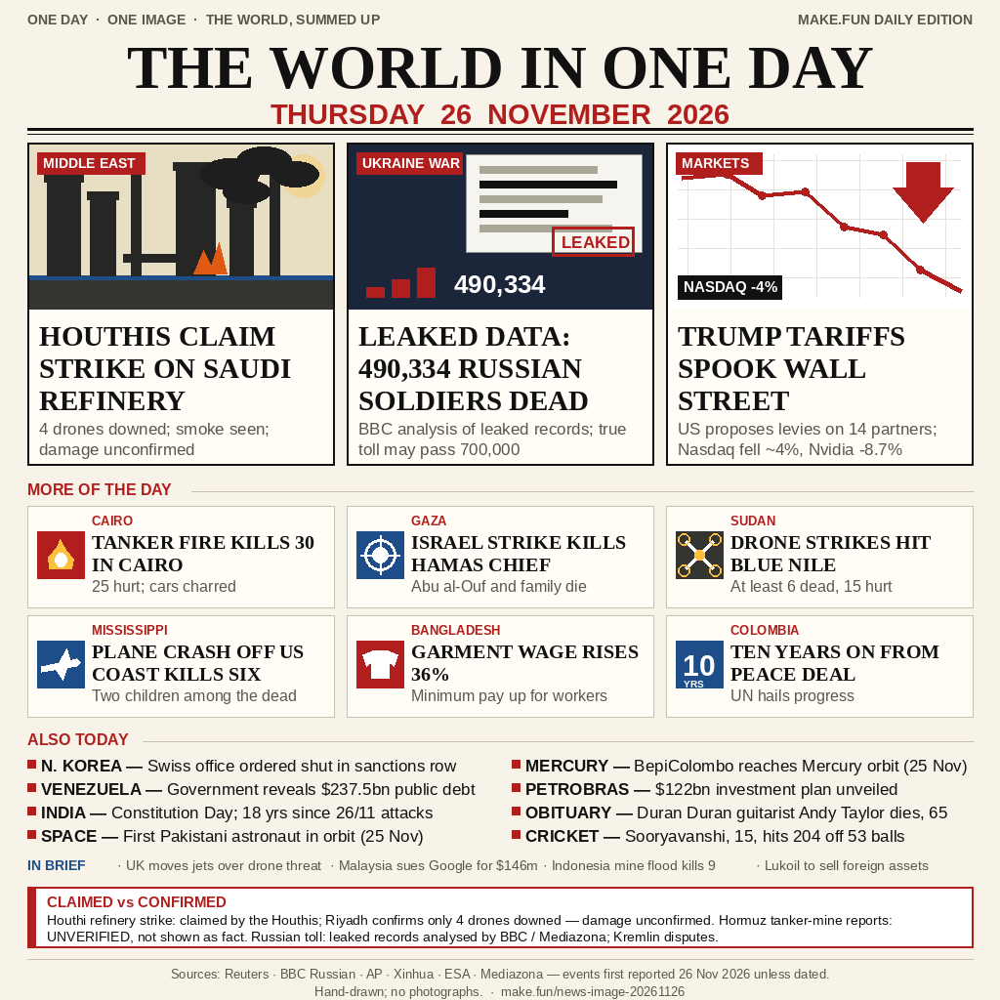

[](https://make.fun/bounty/news-image-20261126)
[](https://make.fun/bounty/news-image-20261126)
[](https://make.fun/bounty/news-image-20261126)

# The World in One Day — Thursday 26 November 2026

One image that sums up the world's news of Thursday 26 November 2026,
drawn as a newspaper front page. Entry for the
[make.fun bounty "Sum up 26 November's world news in one image"](https://make.fun/bounty/news-image-20261126).



## What the page shows

**Masthead:** "THE WORLD IN ONE DAY — THURSDAY 26 NOVEMBER 2026", so the
day the image sums up is named on the image itself.

**Three big stories, drawn as scenes:**

- **Houthis claim a strike on Saudi Arabia's Ras Tanura refinery** — the
  kingdom's largest (550,000 barrels a day). Riyadh says its defences
  downed four drones; satellite pictures show smoke; damage is
  unconfirmed, and the image says so.
- **Leaked Russian records: 490,334 soldiers dead in Ukraine** — a BBC
  analysis of leaked Rosstat death records; the true toll may pass
  700,000. The Kremlin says only the defence ministry may report figures.
- **Trump tariffs spook Wall Street** — the US proposes new levies on 14
  trading partners; the Nasdaq fell about 4% in the session and Nvidia
  about 8.7%, ahead of the Thanksgiving holiday.

**More of the day:** a tanker fire that killed at least 30 on Cairo's
ring road; an Israeli strike that killed a senior Hamas official and his
family in Gaza; drone strikes in Sudan's Blue Nile; a plane crash off
the Mississippi coast that killed six, two of them children; a 36%
garment-wage rise in Bangladesh; and ten years on from Colombia's peace
deal.

**Also today:** North Korea ordering Switzerland's office shut, Venezuela
revealing $237.5bn of public debt, India marking Constitution Day and 18
years since the 26/11 Mumbai attacks, the first Pakistani astronaut in
orbit, BepiColombo reaching Mercury, Petrobras's $122bn plan, the death
of Duran Duran guitarist Andy Taylor, and a 15-year-old's 204 off 53
balls in cricket.

**Claimed vs confirmed:** a small box on the page separates what is
claimed from what is confirmed — the Houthi refinery hit is a claim,
not a confirmed strike, and unverified reports (such as tanker mines in
the Strait of Hormuz) are not shown as fact. Events first reported on
25 November are labelled with that date.

## How it works

`main.ts` (Node 22, standard library only) reads the `entry.png` shipped
in this repository, checks it is a whole, well-formed PNG — signature,
1024×1024 8-bit RGB header, every chunk's CRC-32, and a complete IEND
trailer — and copies it byte for byte to `$MAKEFUN_OUTPUT_DIR/entry.png`
(default `/output`). It writes the same bytes on every run and refuses
a truncated or corrupted file instead of writing anything.

```sh
mkdir -p out && MAKEFUN_OUTPUT_DIR=out node main.ts
```

## Sources

Reuters, BBC Russian, AP, Xinhua, ESA, Mediazona. All events were first
reported on 26 November 2026 unless the image dates them otherwise.
The drawings are original and hand-made for this entry; no photographs
are used.

## License

0BSD — see [LICENSE](LICENSE).
